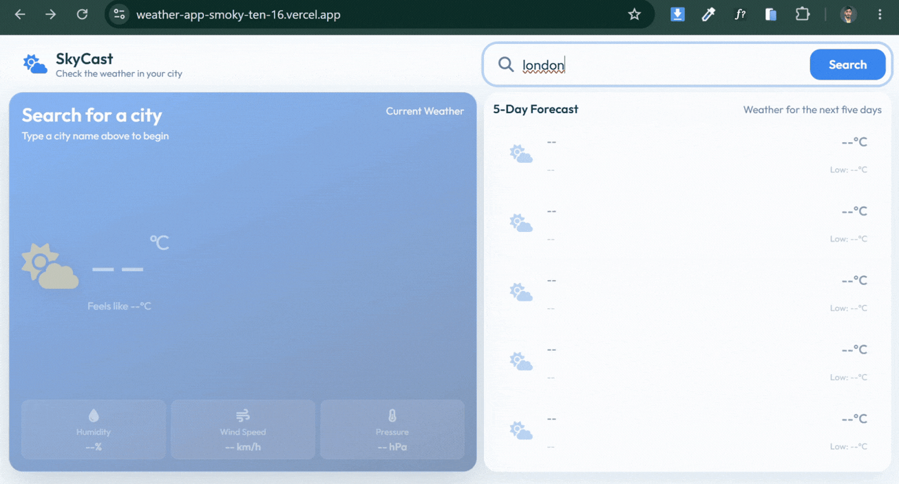

# 🌦️ Weather App

### Check the weather. Explore the forecast. Find your city.

A responsive weather app built with JavaScript and the Open-Meteo API. Search for a location, explore current weather conditions, and check the forecast for the next five days.

<p align="center">
  <a href="https://weather-app-smoky-ten-16.vercel.app/">
    
  </a>
  <a href="https://github.com/GhaZanfar377/weather-app">
    
  </a>
</p>

---

## 🎬 App Preview

<p align="center">
  
</p>

## 🛠️ Built With

<p align="center">
  
</p>

<p align="center">
  <a href="https://open-meteo.com/">
    
  </a>
  <a href="https://vercel.com/">
    
  </a>
</p>

## ✨ Features

- 🔎 **City Search** — Find locations by entering a city name.
- 💡 **Live Suggestions** — Get location suggestions while typing.
- 🌡️ **Current Weather** — View weather information for the selected location.
- 📅 **5-Day Forecast** — Explore the upcoming forecast.
- ⚡ **Debounced Search** — Reduce unnecessary API requests while typing.
- 🔄 **Async Request Handling** — Handle changing searches and delayed responses.
- 🛡️ **Error Handling** — Handle failed requests instead of allowing them to break the experience.
- 📱 **Responsive Layout** — Use the app on desktop and mobile screens.

## ⚙️ How It Works

1. Enter a city name in the search field.
2. Choose a location from the suggestions.
3. The app retrieves weather information for that location.
4. Current conditions and the five-day forecast appear on the screen.

The search experience also accounts for asynchronous behavior. Requests may take different amounts of time, so the app needs to avoid displaying outdated results when the user's search changes.

## 🧠 What I Practised

This project helped me connect several JavaScript concepts in one application:

- Fetching data from APIs using `fetch()`.
- Working with `async` and `await`.
- Handling errors with `try...catch`.
- Updating the DOM with API data.
- Using debouncing for city search.
- Managing changing requests and outdated responses.
- Organizing functions and reducing repeated code.
- Using Git commits, branches, and merges during development.

## 🚀 Run Locally

**1. Clone the repository**

```bash
git clone https://github.com/GhaZanfar377/weather-app.git
```

**2. Open the project folder**

```bash
cd weather-app
```

**3. Run the application**

Open `index.html` in your browser. You can also use a local development server.

No package installation is listed here because the repository's current file listing shows a plain HTML, CSS, and JavaScript structure.

## 🌐 API

Weather data and location search use [Open-Meteo](https://open-meteo.com/).

Visit its documentation to learn more about the available weather and geocoding endpoints.

## 🔮 Possible Improvements

- Add more detailed weather information.
- Improve loading and empty-search states.
- Add additional location-related features.
- Continue improving request handling and accessibility.

---

<p align="center">
  <b>Built with JavaScript, curiosity, and a willingness to debug. ☁️</b>
</p>


---

## Connect with Me

**Ghazanfar Iqbal** · Frontend Developer

[](www.linkedin.com/in/ghazanfar-iqbal-b0a58638b)
